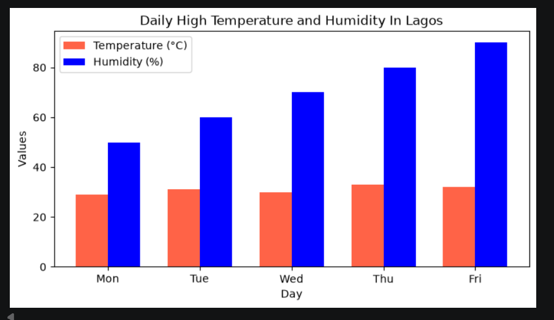
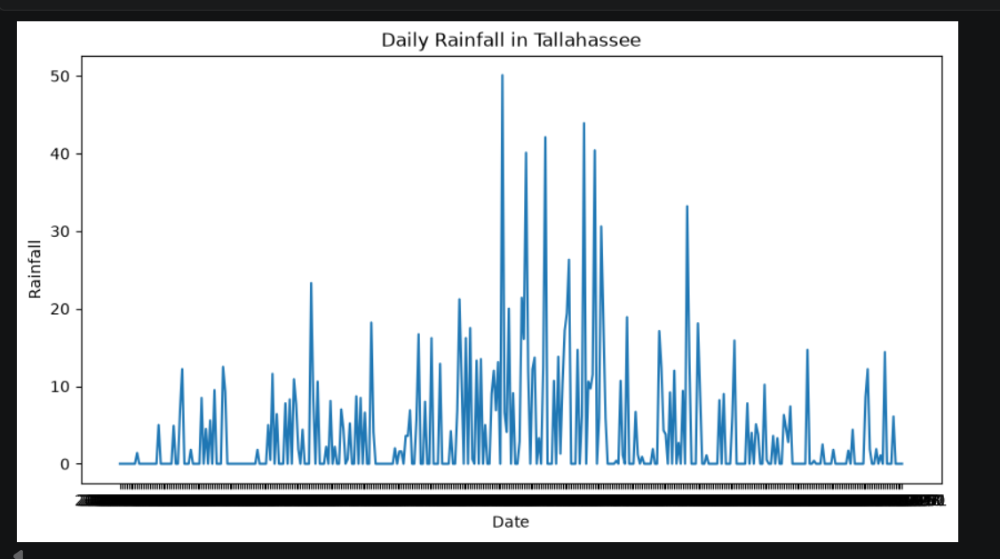

# Urban Climate and Meteorological Exploratory Data Analysis (EDA) Using Python

This project uses Python to explore meteorological datasets from Lagos, Nigeria, and Tallahassee, Florida. The analysis focuses on daily high temperatures, humidity levels and rainfall patterns, using Pandas for data manipulation and Matplotlib for visualization.

## Table of Contents

- [Dashboard Preview](#dashboard-preview)
- [Introduction](#introduction)
- [Data Overview and Dataset Structure](#data-overview-and-dataset-structure)
- [Data Cleaning and Preparation](#data-cleaning-and-preparation)
- [Python Analysis and Techniques](#python-analysis-and-techniques)
- [Dashboard Analysis](#dashboard-analysis)
- [Conclusion](#conclusion)
- [Recommendations](#recommendations)
- [Assumptions and Limitations](#assumptions-and-limitations)
- [How to View the Analysis](#how-to-view-the-analysis)
- [Tools and Repository Structure](#tools-and-repository-structure)
- [Author](#author)

## Dashboard Preview

### Lagos: Daily High Temperature and Humidity



*Figure 1: Grouped bar chart comparing daily high temperatures (°C) and humidity percentages (%) from Monday to Friday in Lagos.*

### Tallahassee: Daily Rainfall Distribution



*Figure 2: Time-series line chart showing daily rainfall fluctuations (mm) across the observation period in Tallahassee.*

## Introduction

Weather conditions influence urban planning, transportation, agriculture, infrastructure and public health. Understanding temperature, humidity and rainfall patterns can help identify weather variations and support better planning and decision-making.

This project uses Python to explore meteorological data from Lagos and Tallahassee, with the aim of identifying patterns in daily high temperatures, humidity levels and rainfall distribution.

The analysis focuses on:

- Exploring daily high-temperature patterns across weekdays in Lagos.
- Comparing temperature and humidity variations.
- Examining daily rainfall distribution in Tallahassee.
- Identifying periods of high rainfall and fluctuations in precipitation.
- Inspecting dataset structures, columns and data types.
- Communicating findings through visualizations.

## Data Overview and Dataset Structure

The project uses structured CSV files containing daily weather observations.

The datasets include:

| Dataset | Description |
|---|---|
| `weather_2025.csv` | Weather records used for the Lagos temperature and humidity analysis |
| `rainfall_raw.csv` | Rainfall records used for the Tallahassee precipitation analysis |

The datasets contain the following analytical fields:

| Column | Description |
|---|---|
| date | Date of the weather observation |
| weekdays | Day of the week |
| temperature_c | Daily high temperature measured in degrees Celsius |
| humidity_percent | Humidity level expressed as a percentage |
| rainfall_mm | Rainfall measured in millimetres |

The analysis covers two locations:

- **Lagos, Nigeria:** Daily high temperatures and humidity levels across weekdays.
- **Tallahassee, Florida:** Daily rainfall distribution across the recorded observation period.

The datasets are treated as public/sample observational meteorological records supplied for exploratory analysis.

## Data Cleaning and Preparation

Before performing the analysis, the datasets were loaded into Pandas DataFrames and inspected to understand their structure and contents.

The preparation process included:

- Importing the CSV files into Python using Pandas.
- Inspecting the first few records using `df.head()`.
- Reviewing column names and data types.
- Examining dataset information using `df.info()`.
- Generating descriptive statistics using `df.describe()`.
- Reviewing the available date, temperature, humidity and rainfall fields before visualization.

These initial checks help establish the structure of the datasets and identify potential data-quality issues that may affect the analysis.

## Python Analysis and Techniques

Python was used to perform exploratory analysis, organize the weather observations and prepare the visualizations.

### 1. Data Loading and Inspection

Pandas was used to import and inspect the CSV datasets.

```python
import pandas as pd
import matplotlib.pyplot as plt

df = pd.read_csv("weather_2025.csv")

df.head()
df.info()
df.describe()
```

### 2. Temperature and Humidity Analysis

The Lagos dataset was explored to compare daily high temperatures and humidity percentages across weekdays, from Monday to Friday.

The analysis used grouped data and a bar chart to make the differences between the two weather variables easier to interpret.

### 3. Rainfall Analysis

The Tallahassee dataset was explored to examine changes in daily rainfall over the observation period.

A time-series line chart was created using Matplotlib to highlight rainfall fluctuations, noticeable spikes and periods of relatively low precipitation.

### 4. Data Visualization

Matplotlib was used to create the following visualizations:

- Grouped bar chart for Lagos daily high temperature and humidity.
- Time-series line chart for Tallahassee daily rainfall.

These visualizations helped communicate the patterns observed in the datasets.

## Dashboard Analysis

### 1. Lagos Temperature and Humidity Analysis

The grouped bar chart compares daily high temperatures and humidity percentages across the working week.

The analysis shows that:

- Daily high temperatures remained relatively stable, generally around 30°C–35°C.
- Humidity levels showed an upward pattern towards the end of the week.
- Humidity peaked above 80% in the supplied observations.

The comparison highlights differences in how temperature and humidity varied during the recorded period.

### 2. Tallahassee Rainfall Analysis

The rainfall visualization presents daily precipitation changes over time.

The analysis highlights:

- Noticeable fluctuations in daily rainfall.
- Distinct rainfall spikes exceeding approximately 40–50 mm.
- Periods of relatively low rainfall between heavier precipitation events.

The visualization makes it easier to identify changes in rainfall intensity across the observation timeline.

## Conclusion

The analysis demonstrates how Python can be used to explore meteorological datasets and communicate weather patterns through data visualization.

The Lagos analysis highlighted relatively stable daily high temperatures alongside variations in humidity, while the Tallahassee analysis revealed fluctuations in daily rainfall and noticeable precipitation spikes.

Overall, the project demonstrates practical skills in data ingestion, data inspection, exploratory data analysis, data aggregation and visualization using Python, Pandas and Matplotlib.

## Recommendations

1. **Urban Infrastructure Planning.** Use rainfall observations to support drainage maintenance and stormwater management planning, particularly around periods of heavy precipitation.

2. **Transportation and Logistics.** Monitor rainfall patterns to help anticipate potential weather-related disruptions to transportation and outdoor operations.

3. **Agricultural Planning.** Use temperature, humidity and rainfall observations as supporting information for weather-dependent agricultural activities.

4. **Further Weather Analysis.** Extend the analysis to cover additional months and years to investigate whether the observed patterns persist over longer periods.

5. **Data Quality Improvement.** Check for missing observations, inconsistent date formats and unusual weather readings before conducting further analysis.

6. **Comparative Climate Analysis.** Include additional locations to compare weather patterns across different geographic and climate zones.

## Assumptions and Limitations

- The analysis is based on the supplied sample meteorological datasets.
- The Lagos analysis focuses on daily high temperatures and humidity across Monday to Friday.
- The Tallahassee analysis focuses on daily rainfall distribution over the available observation period.
- The analysis assumes that the supplied measurements are recorded consistently.
- Sensor calibration and the accuracy of the original weather observations were not independently verified.
- The findings are limited to the available observation periods and should not be interpreted as long-term climate trends.
- The analysis identifies patterns in the supplied records but does not establish the causes of observed weather variations.

## How to View the Analysis

- **Quick look:** Open the visualizations in the `images/` folder.
- **Python analysis:** Open the Jupyter Notebook in the `notebooks/` folder.
- **Datasets:** The original CSV files are available in the `data/` folder.

For the best experience, open the notebook in Jupyter Notebook or JupyterLab and run the cells to explore the analysis.

## Tools and Repository Structure

**Tools:** Python, Pandas, Matplotlib and Jupyter Notebook.

```text
urban-climate-eda-python/
│
├── README.md
├── data/
│   ├── weather_2025.csv
│   └── rainfall_raw.csv
├── notebooks/
│   └── climate_eda_analysis.ipynb
└── images/
    ├── lagos-temp-humidity.png
    └── tallahassee-rainfall.png
```

## Author

Sholagberu Logun Khadijat

Data Analyst | Excel, Power BI, SQL, & Python

[E-mail](khadijahlogun@gmail.com)
| [Linkedin](https://www.linkedin.com/in/logun-khadijah-b721a0270?)
